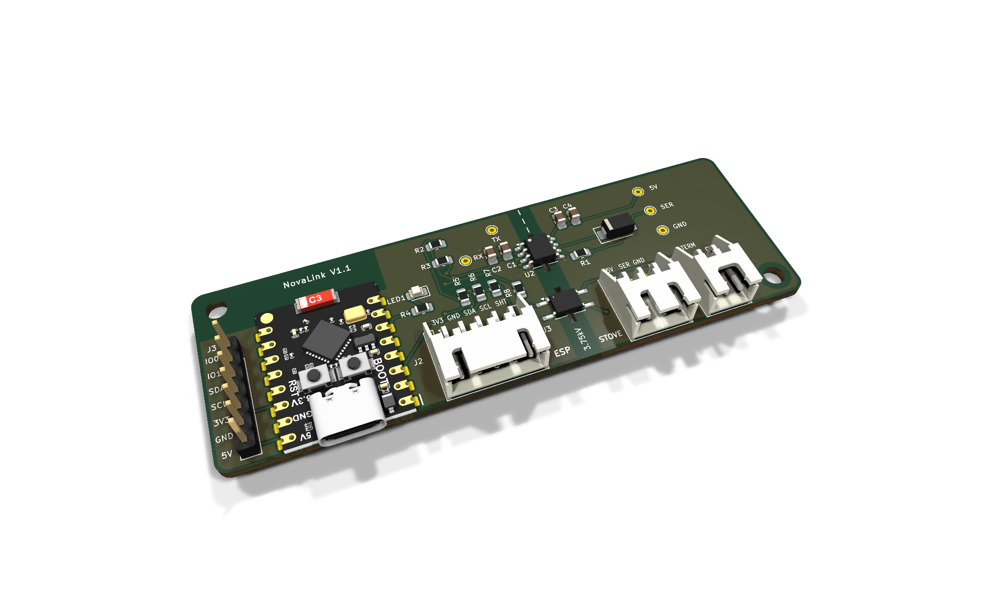
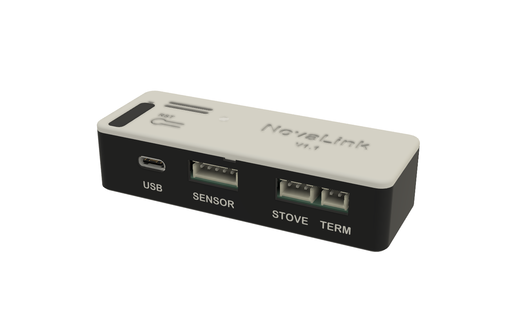

# NovaLink V1

**Galvanically isolated ESP32-C3 interface for Micronova-controlled pellet stoves (NAVEL INSIDE port).**

NovaLink plugs into the 3-pin service port of a Micronova stove board (designed for X100 EVO "NAVEL INSIDE" connector,
+5 V / SER / GND, 19200 baud single-wire serial) and lets an ESP32-C3 SuperMini talk to the stove through a
3.75 kV digital isolator. The stove side is powered by the stove itself; the ESP side is powered by USB-C.
An optional VL53L0X or VL6180X (TOF050C module) time-of-flight sensor can be connected (for example to measure the pellet level).

An isolated dry-contact output (J4) drives the stove's external thermostat input (TERM), so that Home
Assistant can regulate on a room sensor placed away from the stove.

> ⚠️ **Status: V1 boards built and running on a Micronova X100 EVO: stove reading, stove control and the ToF sensor
> work. The thermostat output (J4) is not tested yet. The enclosure needs rework (see Enclosure).**
>
> This is a hobby project, not affiliated with or endorsed by Micronova. Opening a stove and connecting to its
> controller is at your own risk and may void the warranty.

## Compatibility

- **NAVEL INSIDE port** (3 pins: +5 V, SER, GND), e.g. Micronova X100 EVO: direct connection to J1.
- **SERIAL port** of other Micronova boards: should work too, through an adapter cable to J1
  (J1 pin 1 = +5 V, pin 2 = SER, pin 3 = GND). The firmware must then use the SERIAL port settings
  (usually 1200 baud, 8N2) instead of 19200 baud. Not tested yet.

> 🔴 **Never connect the 20 V line of the SERIAL port.** The SERIAL connector carries an extra supply line
> (about 15–20 V) next to +5 V, SER and GND. Only +5 V, SER and GND go to NovaLink: 20 V on J1 pin 1 would destroy
> the stove side of the board (the isolator supply is limited to 5.5 V, 6 V absolute maximum) and could damage the stove controller.
> Pin order differs between boards: identify each pin with a multimeter before wiring.

## Features

- **Isolation**: CA-IS3721HS digital isolator (Chipanalog), 3750 Vrms, 1 channel each way, fail-safe output high
  (if the ESP is unpowered, the stove line is left idle). 4 mm copper-free barrier with 1 mm milled slots under the
  isolator and under the thermostat relay (each slot runs 1.5 mm past both ends of its package to lengthen the creepage path). Separate grounds `GND_ESP` / `GND_STOVE`.
- **Stove line (SER)**: open-drain style transmit through an SS14 Schottky diode (the board only pulls SER low),
  receive through a 1 kΩ resistor. No TVS on SER on purpose: the line is only pulled up by ~38 kΩ inside the stove,
  extra capacitance would slow the edges.
- **ESP32-C3 SuperMini** (hand soldered), its edge flush with the board edge so the USB-C protrudes by 1.3 mm.
- **ToF sensor connector** (JST XH 5 pins) with 2.2 kΩ I²C pull-ups and 100 Ω series resistors on the cable lines.
- **Extension header** (7 pins, 2.54 mm): GPIO0, GPIO1, I²C, 3V3, GND, 5V (USB).
- **Status LED** on GPIO10, test points for TX, RX, 5V, SER and GND.
- **Thermostat output**: Omron G3VM-61VY3 MOSFET relay (3.75 kVrms, 60 V, 0.7 A), normally open dry contact
  on J4 for the stove TERM input, driven by GPIO3 (removed from J3).
- 89 × 30 mm, 2 layers, all SMD parts in 0805 / SOIC / SOP / SMA (hand-solderable).
- 3D-printable enclosure with captive M3 nuts, magnets and a snap-fit lid.

## Repository layout

| Path | Content |
|---|---|
| `NovaLink.kicad_*` | KiCad 10 project (schematic, PCB) |
| `libs/` | Project library: CA-IS3721HS, G3VM-61VY3 and ESP32-C3 SuperMini symbols, ESP32-C3 SuperMini footprint |
| `production/` | Manufacturing files: `NovaLink.zip` (Gerbers + drill), `bom.csv`, `positions.csv` |
| `docs/` | Schematic PDF, PCB renders, board STEP |
| `enclosure/` | Enclosure: STL, multi-colour 3MF and STEP files |

## Schematic

[docs/NovaLink_schematic.pdf](docs/NovaLink_schematic.pdf) — one A4 sheet, six blocks: ESP32-C3 SuperMini and LED,
isolation and stove connector, test points and mounting holes, ToF sensor, extension header, thermostat output.

### ESP32-C3 SuperMini pins

| Function | GPIO | Notes |
|---|---|---|
| TX to stove | GPIO5 | UART1 TX (GPIO21 is avoided: it prints the ROM boot log) |
| RX from stove | GPIO20 | UART1 RX |
| I²C SDA / SCL | GPIO6 / GPIO7 | shared between J2 and J3 |
| Sensor XSHUT | GPIO4 | |
| Status LED | GPIO10 | active high |
| Thermostat output | GPIO3 | high = contact closed |
| On J3 only | GPIO0, GPIO1 | |
| Unused | GPIO2, GPIO8, GPIO9, GPIO21 | strapping / boot pins |

### Connectors

| Ref | Type | Pinout |
|---|---|---|
| J1 (stove) | JST XH 3 pins, right angle | 1 = +5V, 2 = SER, 3 = GND (stove side, isolated) |
| J2 (ToF sensor) | JST XH 5 pins, right angle | 1 = 3V3, 2 = GND, 3 = SDA, 4 = SCL, 5 = XSHUT |
| J3 (extension) | 1×7 pin header 2.54 mm | IO0, IO1, SDA, SCL, 3V3, GND, 5V (USB, not isolated) |
| J4 (stove TERM) | JST XH 2 pins, right angle | 1, 2 = dry contact to the stove TERM input, no polarity (isolated) |

## Bill of materials

[production/bom.csv](production/bom.csv) (values, packages, LCSC part numbers). U1, the ESP32-C3 SuperMini
(U.FL version recommended), is not in the file: it is hand soldered.

## Thermostat output

Micronova boards have an external thermostat input (TERM, a normally open dry contact). On the boards documented by
Micronova (I023, N100), the contact works as follows:

| J4 contact | STAND-BY off (default) | STAND-BY on |
|---|---|---|
| Closed (GPIO3 high) | WORK at the set power | WORK |
| Open (GPIO3 low, ESP off) | MODULATION (minimum power, flame on) | MODULATION, then shutdown after Pr44, restart when the contact closes |

The stove still heats while its own room probe is below its set point (probe **or** contact). To let the contact
alone decide, set the stove set point to 7 °C; a higher value (for example 15 °C) keeps the stove probe as a backup
if Home Assistant or the ESP fails.

> ⚠️ Not yet checked on the X100 EVO.

## Enclosure

> ⚠️ **This enclosure needs rework: do not print it yet.**

Ready-to-print files in `enclosure/`: `NovaLink_enclosure_base.stl`, `NovaLink_enclosure_lid.stl`,
`NovaLink_enclosure_led_window.stl` and `NovaLink_enclosure_j3_cover.stl`. For a multi-colour printer:
`NovaLink_enclosure_base_multicolor.3mf` (base + white connector names, also as
`NovaLink_enclosure_base_labels.stl`) and `NovaLink_enclosure_lid_multicolor.3mf` (lid + clear LED window),
one filament per body.
`NovaLink_enclosure.step` to adapt the enclosure in any CAD tool. The enclosure was checked against the
KiCad 3D model of the board (`docs/NovaLink.step`): no interference.

- Outside 94 × 33.8 × 22.5 mm, openings for USB-C (tight rounded opening, the receptacle is flush with the 1.2 mm
  front wall), J2 (sensor) and J1 + J4 (stove, TERM), slot above J3.
- Small cover closing the J3 slot when the header is not used: flush in a recess of the lid, friction fit,
  fingernail notch to remove it.
- Board held by two M3 × 10 screws into M3 nuts caged inside the base, plus a support peg. Pause the print at Z = 3.0 mm (top of the hexagonal pockets), drop an M3 nut in each pocket, then resume: the nuts end up fully enclosed (closed 0.4 mm skin below, no hole through the underside). M3 × 10 is the longest screw that fits: 10.2 mm from the board top down to the skin.
- 4 pockets for Ø10 × 3 mm magnets to stick the box to the back of the stove.
- Snap-fit lid, removable with a flat screwdriver (notch at the front).
- Connector names on the front wall, under the openings: 0.4 mm inlay in a second colour (or plain engraving
  with a single-colour printer).
- Lid: engraved name, vent slots, flexible reset key (round pad on a thin beam, pusher on the SuperMini RST
  button, the one on the J3 side) and a transparent light pipe above the status LED, in an opaque sleeve.
- Print the lid top face down, in **PETG or ASA**, not PLA (the back of a stove gets warm); LED window in clear PETG,
  J3 cover cap face down.

## Firmware

The firmware is an ESPHome external component, in its own repository:
[benbox69/novalink-firmware](https://github.com/benbox69/novalink-firmware). It reads the stove, controls it (on/off,
setpoint, power level) and runs a protection in the board itself. A ready-to-use configuration for this board is in
its `examples/` folder.

No pin inversion is needed (the isolator and the diode keep the logic levels). 19200 baud is for the NAVEL INSIDE port;
the SERIAL port usually uses 1200 baud, 8N2 (see Compatibility).

> ⚠️ On the X100 EVO, never write to RAM address 0x58: it raises the "fumes probe" alarm.

## 3D model of the SuperMini

The ESP32-C3 SuperMini 3D model is not included. Download it (CC0) from
[Printables – ESP32 C3 Super mini model by Josselin Hefti](https://printables.com/model/1360390-esp32-c3-super-mini-model)
and save the STEP file as `libs/3d/ESP32-C3-SuperMini.step`; the footprint already points to it.

## License

NovaLink (hardware design, enclosure and documentation) is licensed under
[Creative Commons Attribution-NonCommercial-ShareAlike 4.0](https://creativecommons.org/licenses/by-nc-sa/4.0/)
(CC BY-NC-SA 4.0): you may build, modify and share it for non-commercial purposes, with attribution and under the
same license. Commercial use or sale is not permitted.
